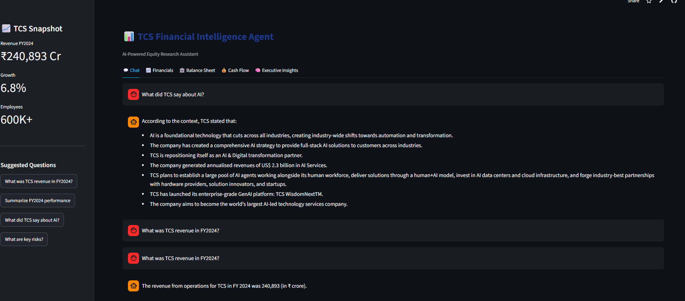

# TCS Financial Intelligence Agent

<p align="center">
  
</p>

**A financial research assistant for TCS disclosures**, combining document ingestion, dense retrieval, BM25, a provenance-backed entity graph and grounded LLM responses.

[](https://financial-intelligence-agent-g.streamlit.app/)
[](https://financial-intelligence-agent-pmgy.onrender.com/)
[](https://www.python.org/)
[](.github/workflows/tests.yml)

## What it does

Users can ask questions about TCS revenue, profitability, cash flow, business segments, AI strategy, risks and management commentary. The system searches annual reports, quarterly disclosures, financial statements, earnings-call transcripts and company news, then generates an answer with supporting source references.

## Architecture

1. **Ingestion:** PDF, CSV and news inputs are transformed into a version-controlled Markdown knowledge repository.
2. **Page-aware chunking:** documents are split into overlapping chunks while retaining source and page metadata when available.
3. **Dense retrieval:** BAAI BGE Small embeddings are stored in ChromaDB.
4. **Lexical retrieval:** BM25 retrieves exact financial terms and figures.
5. **Knowledge graph:** NetworkX stores financial entities, reporting periods and evidence-chunk nodes. `MENTIONS` edges connect entities to source evidence; `CO_MENTIONED_WITHIN_CHUNK` edges record provenance-backed co-occurrence.
6. **Hybrid ranking:** reciprocal-rank fusion combines dense, BM25 and graph results.
7. **Generation:** Groq-hosted Llama answers from retrieved context and is instructed to cite source IDs.
8. **Serving:** FastAPI exposes question-answering endpoints; Streamlit provides the user interface and financial dashboards.

> Graph edges describe evidence co-mentions, not causality or directional business relationships. This project uses a local NetworkX graph; it does not require a Neo4j server.

## Data coverage

The repository contains TCS annual reports, quarterly financial reports and earnings-call transcripts, financial statement/ratio data, company profile information and a collection of company news documents. Source files are retained in the `knowledge/` directory for auditability.

## Local setup

```bash
pip install -r backend/requirements.txt
```

Configure `GROQ_API_KEY` in the environment. Optionally set `HF_TOKEN`, `EMBEDDING_MODEL` and `GROQ_MODEL`.

Rebuild vector and graph indexes after changing source documents:

```bash
python -m backend.rag.build_vector_db
```

To build only the graph from an existing Chroma collection:

```bash
python -m backend.rag.build_graph_from_collection
```

Run the API:

```bash
uvicorn backend.api.main:app --host 0.0.0.0 --port 10000
```

## API

- `GET /` service metadata
- `GET /health` health check
- `GET /ask?question=...` question answering
- `POST /ask` JSON request: `{"question":"What was TCS revenue in FY2024?"}`

Responses include the answer, source filename, page where available, chunk ID, score and retrieval methods. Older Markdown files without page markers need to be regenerated from their original PDFs to support page-level citations.

## Evaluation

A lightweight offline evaluation module provides Recall@K, MRR@K and citation-coverage calculations. Add manually reviewed question-to-chunk relevance labels before reporting retrieval scores. Also manually inspect citation correctness, faithfulness, answer relevance and abstention on questions with no supporting evidence. Compare dense-only, dense+BM25 and dense+BM25+graph on the same frozen benchmark.

GitHub Actions runs the automated test suite on pushes and pull requests.

## Limitations and next steps

- The initial entity extractor is deterministic and focused on common TCS/financial concepts; it is not a general-purpose financial NER model.
- Graph edges are evidence co-mentions, not causal or semantic predicates.
- Existing source documents without page markers cannot provide page-accurate citations until re-ingested.
- Benchmark scores should only be reported after relevance labels and answer audits are reviewed.
- Outputs are research assistance, not investment advice.
