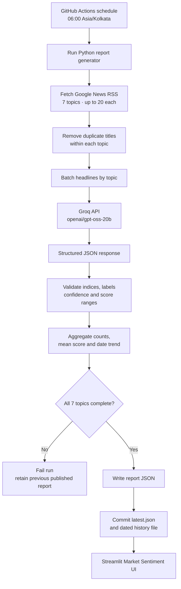
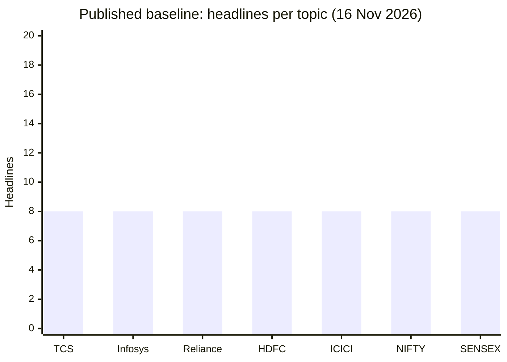
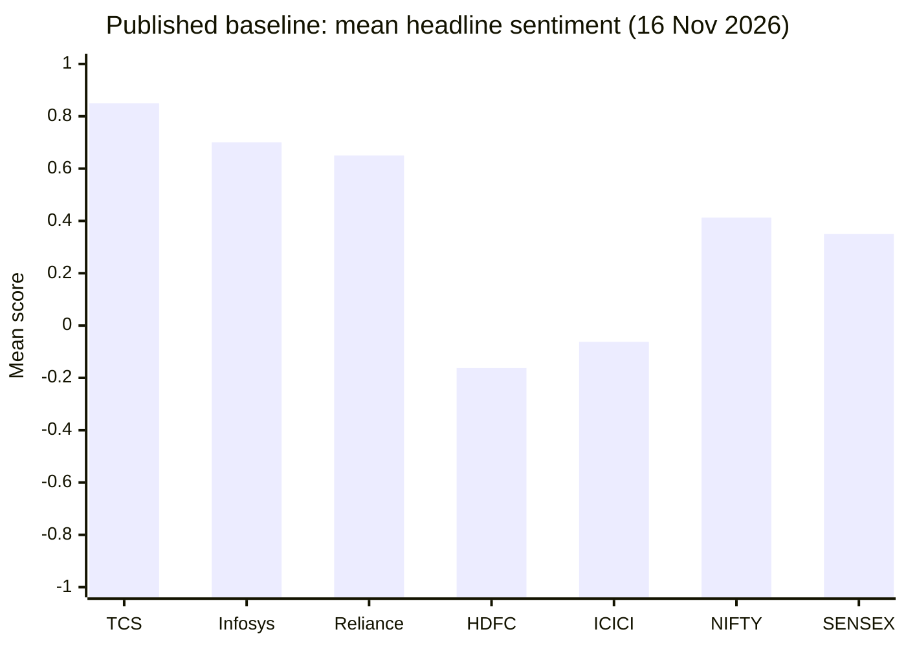

# TCS Financial Intelligence Agent

<p align="center">
  
</p>

**A financial research assistant for TCS disclosures**, combining document ingestion, dense retrieval, bounded lexical retrieval, a provenance-backed entity graph and grounded LLM responses.

[](https://financial-intelligence-agent-g.streamlit.app/)
[](https://financial-intelligence-agent-pmgy.onrender.com/)
[](https://www.python.org/)
[](.github/workflows/tests.yml)

## What it does

Users can ask questions about TCS revenue, profitability, cash flow, business segments, AI strategy, risks and management commentary. The system searches annual reports, quarterly disclosures, financial statements, earnings-call transcripts and company news, then generates an answer with supporting source references.

## Architecture

1. **Ingestion:** PDF, CSV and news inputs are transformed into a version-controlled Markdown knowledge repository.
2. **Page-aware chunking:** documents are split into overlapping chunks while retaining source and page metadata when available.
3. **Offline document indexing:** GitHub Actions uses Groq's `nomic-embed-text-v1_5` embedding endpoint to build normalized 768-dimensional document vectors, then publishes the ChromaDB vectors and NetworkX graph as a versioned GitHub Release asset.
4. **Query embedding:** FastAPI generates each normalized query vector through the same Groq embedding model. The Streamlit client sends only the question text; no local embedding model or Hugging Face download is used.
5. **Lexical retrieval:** the live API uses bounded Chroma document-term candidates to stay within its memory budget. A full-corpus BM25 implementation is used as an offline evaluation baseline.
6. **Knowledge graph:** NetworkX stores financial entities, reporting periods and evidence-chunk nodes. Typed edges distinguish `MENTIONS`, `HAS_EVIDENCE_IN_PERIOD`, `PRECEDES`, qualitative trend evidence and `CO_MENTIONED_WITHIN_CHUNK`. Co-mentions are not causal relationships; trend nodes are unverified qualitative observations.
7. **Hybrid ranking:** reciprocal-rank fusion combines dense, bounded lexical and graph candidates in the live API.
8. **Generation:** Groq-hosted GPT OSS answers from retrieved context and is instructed to cite source IDs.
9. **Serving:** FastAPI exposes question-answering endpoints; Streamlit provides the user interface and financial dashboards.

> Graph edges describe evidence co-mentions, not causality or directional business relationships. This project uses a local NetworkX graph; it does not require a Neo4j server.

## Data coverage

The repository contains TCS annual reports, quarterly financial reports and earnings-call transcripts, financial statement/ratio data, company profile information and a collection of company news documents. Source files are retained in the `knowledge/` directory for auditability.

## Local setup

```bash
pip install -r backend/requirements.txt
```

Configure `GROQ_API_KEY` in the Render environment and in GitHub Actions repository secrets. The frontend does not need the key; it sends only the question text. Groq handles both query/document embeddings and answer generation.

Document vectors are built by the GitHub Actions workflow **Build and publish RAG index**. It runs automatically when files under `knowledge/` or indexing code change, and can also be started manually from the Actions tab. The workflow publishes `tcs-rag-index.zip` as a versioned GitHub Release asset. Render downloads the latest release during startup; the index is not committed into the source tree.

For a local rebuild, configure `GROQ_API_KEY` and run:

```bash
python -m backend.rag.build_vector_db
```

The index builder, FastAPI query path and benchmark all use the same Groq-hosted `nomic-embed-text-v1_5` model. No Hugging Face account, token, local model download, PyTorch or SentenceTransformers installation is required.

To build only the graph from an existing Chroma collection:

```bash
python -m backend.rag.build_graph_from_collection
```

Run the API:

```bash
uvicorn backend.api.main:app --host 0.0.0.0 --port 10000
```

## API

- `GET /` service metadata
- `GET /health` liveness check\n- `GET /ready` readiness check for Chroma, graph index and Groq configuration
- `GET /ask?question=...` question answering
- `POST /ask` JSON request: `{"question":"What was TCS revenue in FY2024?"}`

Responses include the answer, source filename, page where available, chunk ID, score and retrieval methods. Older Markdown files without page markers need to be regenerated from their original PDFs to support page-level citations.

## Public market data and news

The Markets & News dashboard uses Yahoo Finance through `yfinance` for quotes/history and Google News RSS for headlines. These sources do not require a paid API key. They are public/unofficial access paths: provider availability, coverage and rate limits can change. Quotes may be delayed and are not exchange-certified real-time prices. Responses are cached briefly in the API process to reduce repeated requests. Always verify prices with the relevant exchange or broker before making decisions.

## Evaluation

A 50-question TCS source-anchored benchmark compares Groq dense-only, full-corpus BM25, dense+BM25 reciprocal-rank fusion, and dense+BM25+graph retrieval. The published table below is the historical BGE run and must not be treated as Groq performance; rerun the benchmark after the Groq index has been rebuilt:

| Method | Recall@5 | MRR@5 |
|---|---:|---:|
| Dense only | 0.0460 | 0.0440 |
| BM25 only (offline baseline) | **0.2782** | 0.1830 |
| Dense + BM25 (RRF) | 0.1354 | 0.1490 |
| Dense + BM25 + graph (RRF) | 0.2474 | **0.2440** |

BM25-only produced the highest Recall@5; graph-assisted fusion had the highest MRR@5. Equal-weight dense+BM25 fusion underperformed BM25 alone. These results measure retrieval against source-anchored relevance labels, not answer accuracy, and the offline BM25 baseline is not the live API lexical implementation.

A 13-question answer audit with top-5 context found 3 correct answers, 1 materially incorrect answer, 1 accounting-basis ambiguity and 8 false abstentions. Citation coverage was 48.7%; citation presence is not proof of source support. The FX-sensitivity question was clarified to ask specifically for the Group figure after the audited run, so that item needs re-evaluation. The review identified period/accounting-basis confusion and missing relevant evidence. See the [full benchmark and answer-audit report](evaluation/reports/tcs-benchmark-review-2026-11-16.md) and [evaluation methodology](evaluation/README.md).

GitHub Actions runs the automated test suite on pushes and pull requests. API safeguards include normalized finite 768-dimensional Groq embedding validation, a process-local per-IP sliding-window request limit, structured JSON logs, readiness checks and explicit Groq rate-limit responses with `Retry-After`.

## Limitations and next steps

- The initial entity extractor is deterministic and focused on common TCS/financial concepts; it is not a general-purpose financial NER model.
- Graph edges are evidence co-mentions, not causal or semantic predicates.
- The benchmark is source-anchored; alternate valid source chunks are not all labelled yet.
- The graph index is being rebuilt with additional financial-statement aliases; the reported comparison uses the previous published index version.
- Answer faithfulness and numerical accuracy need further improvement before making high-accuracy claims.
- Existing source documents without page markers cannot provide page-accurate citations until re-ingested.
- Outputs are research assistance, not investment advice.


### Retrieval evaluation benchmark

The repository includes a 50-question TCS benchmark, a full-corpus BM25 offline baseline and a 13-question generated-answer audit packet. See [the benchmark report](evaluation/reports/tcs-benchmark-review-2026-11-16.md) for measured results and limitations. The workflow publishes JSON reports as a GitHub Actions artifact. Automated numeric and citation checks are screening signals; human review of faithfulness, accounting period, units and source support remains required before claiming answer-quality scores. The current BGE retrieval metrics are retained only as a historical baseline; the Groq results will replace them after the new index and benchmark workflow complete.

---

## Daily Market Sentiment Intelligence

The project also publishes a daily, precomputed financial-news sentiment report for seven Indian companies and market benchmarks. The report is generated by GitHub Actions using Google News RSS headlines and Groq-hosted `openai/gpt-oss-20b`, then consumed by the Streamlit Market Sentiment page.

### Coverage

The daily report covers:

| Key | Company / benchmark | RSS search topic |
|---|---|---|
| `tcs` | TCS · Tata Consultancy Services | Tata Consultancy Services TCS |
| `infosys` | Infosys | Infosys India |
| `reliance` | Reliance Industries | Reliance Industries |
| `hdfc_bank` | HDFC Bank | HDFC Bank |
| `icici_bank` | ICICI Bank | ICICI Bank |
| `nifty50` | NIFTY 50 | NIFTY 50 Indian stock market |
| `sensex` | SENSEX | BSE Sensex Indian stock market |

**Collection target:** up to 20 unique headlines per topic (up to 140 across all seven topics). Google News RSS may return fewer than 20 relevant unique items for a query, so 140 is a maximum target, not a guaranteed daily count. The collector removes duplicate titles within each topic. A headline may still appear in more than one topic if it is relevant to multiple searches.

### Sentiment pipeline



### Classification and metrics

Each headline receives:
- **Label:** positive, negative or neutral.
- **Confidence:** model-reported value from 0 to 1. It is not a calibrated probability.
- **Sentiment score:** model-reported value from -1 to +1. Negative values indicate adverse tone; positive values indicate favourable tone; values near zero indicate neutral or mixed tone.
- **Evidence metadata:** headline, publisher, source URL and publication date.

For a topic with (N) classified headlines, the aggregate sentiment score is the arithmetic mean:

`mean sentiment = (sum of headline sentiment scores) / N`

The aggregate label uses the current generator thresholds:
- Positive: mean score greater than +0.08.
- Negative: mean score less than -0.08.
- Neutral: otherwise.

Positive, negative and neutral article counts are calculated directly from the headline labels. The daily trend groups scored headlines by publication date and reports the mean score and article count for each date.

> These values describe the tone of the retrieved news text. They are not stock-return forecasts, calibrated sentiment probabilities, trading signals, or investment advice.

### Current published baseline

The following is the actual published report from **16 November 2026**, before the increase from 8 to 20 headlines per topic. It is included as a reproducible baseline, not as a current 20-headline result.

| Company / benchmark | Articles | Positive | Neutral | Negative | Mean score | Label |
|---|---:|---:|---:|---:|---:|---|
| TCS | 8 | 8 | 0 | 0 | +0.8500 | Positive |
| Infosys | 8 | 7 | 1 | 0 | +0.7000 | Positive |
| Reliance | 8 | 7 | 1 | 0 | +0.6500 | Positive |
| HDFC Bank | 8 | 0 | 6 | 2 | -0.1625 | Negative |
| ICICI Bank | 8 | 0 | 7 | 1 | -0.0625 | Neutral |
| NIFTY 50 | 8 | 5 | 3 | 0 | +0.4125 | Positive |
| SENSEX | 8 | 6 | 0 | 2 | +0.3500 | Positive |
| **Total** | **56** | **33** | **18** | **5** | — | — |

#### Baseline article-volume chart



#### Baseline sentiment-score chart



### Report storage and access

- Latest report: [`sentiment-data/latest.json`](https://github.com/Harshithpatali/financial-intelligence-agent/blob/sentiment-data/latest.json)
- Daily history: [`sentiment-data/history/`](https://github.com/Harshithpatali/financial-intelligence-agent/tree/sentiment-data/history)
- Workflow: [Daily Groq sentiment report](https://github.com/Harshithpatali/financial-intelligence-agent/actions/workflows/daily_sentiment.yml)
- Generator: [`scripts/generate_sentiment_report.py`](scripts/generate_sentiment_report.py)

The workflow runs daily at 00:30 UTC (06:00 IST) and can also be started manually from GitHub Actions. It requires the repository Actions secret `GROQ_API_KEY`; the key is not written to the report branch. The workflow publishes only when all seven topics are successfully collected and classified. An incomplete run fails rather than replacing the previous good report.

### Reproduce locally

Python 3.11 or newer is recommended.

```bash
python -m pip install groq
export GROQ_API_KEY="your-groq-api-key"
python scripts/generate_sentiment_report.py --output sentiment-report.json
```

On Windows PowerShell:

```powershell
python -m pip install groq
$env:GROQ_API_KEY="your-groq-api-key"
python scripts/generate_sentiment_report.py --output sentiment-report.json
```

### Validation and quality controls

Automated tests cover the configured topic universe, model identifier, collection limit, classification order and output score ranges. The report generator additionally checks that every headline index is present exactly once, every label belongs to the supported set, confidence is within [0, 1], and sentiment score is within [-1, 1].

Recommended next evaluation steps:
1. Build a manually labelled benchmark of representative Indian financial headlines.
2. Measure label accuracy, macro-F1 and per-class precision/recall against human labels.
3. Review false positives, false negatives, neutral/mixed cases and duplicate or low-relevance stories.
4. Track daily coverage, publisher concentration, missing publication dates and API failures.
5. Compare model scores with a second reviewer or model before using them in research decisions.

No accuracy, F1, calibration or predictive-return metric is claimed yet because a human-labelled evaluation benchmark has not been completed.
